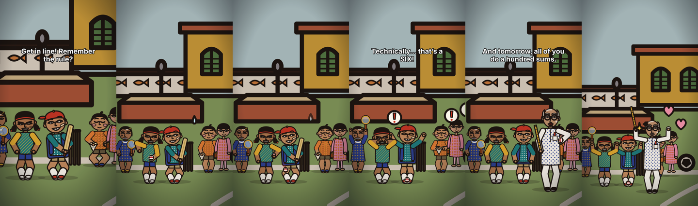
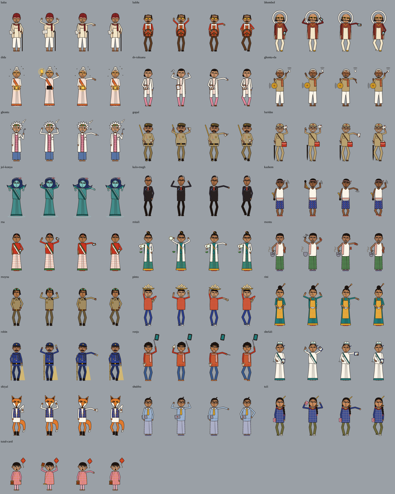
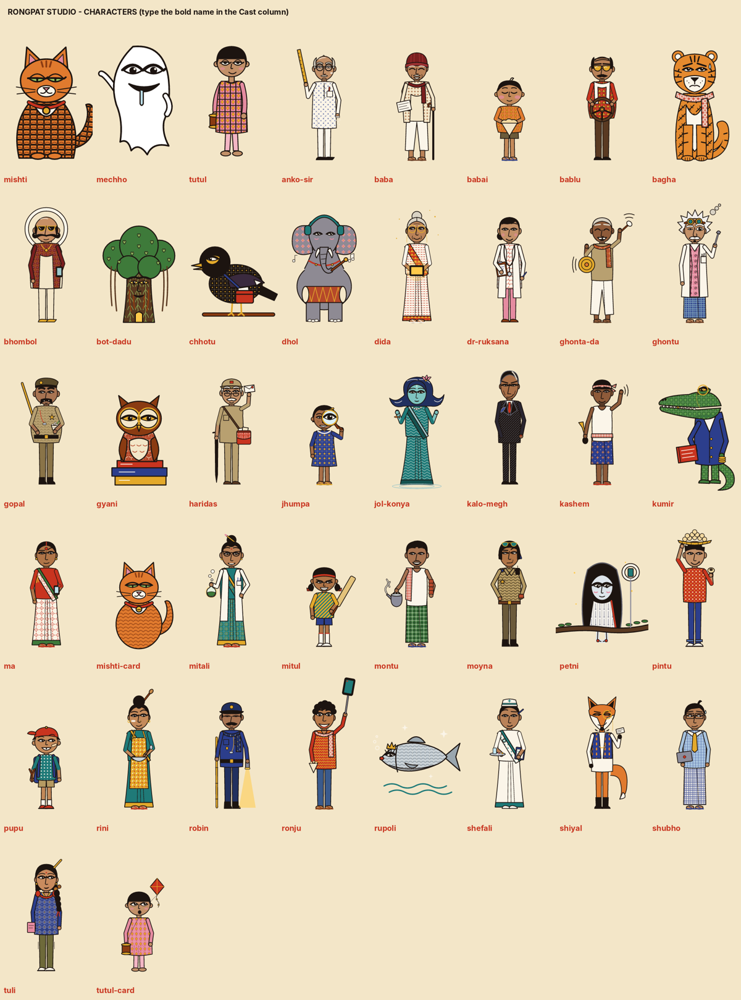
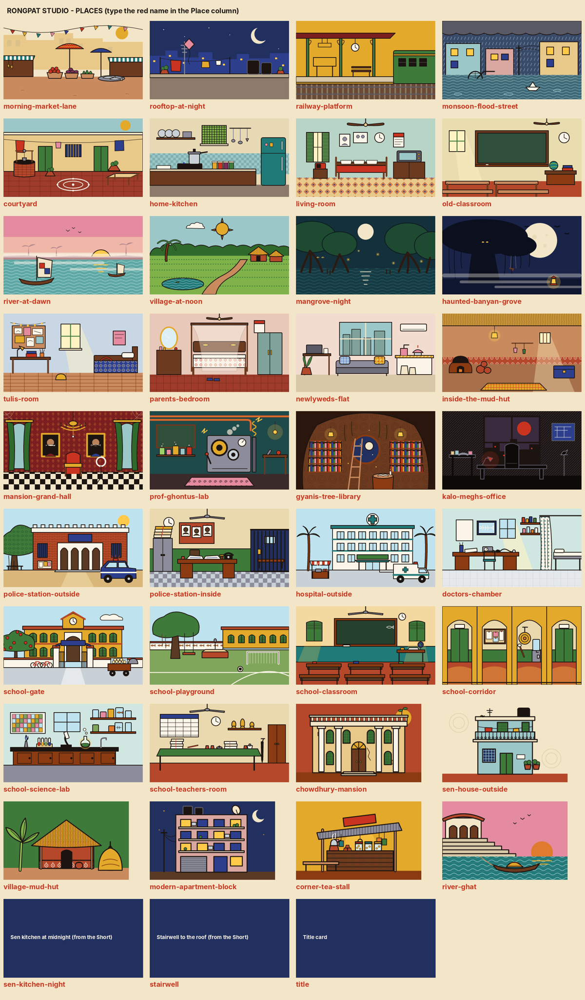
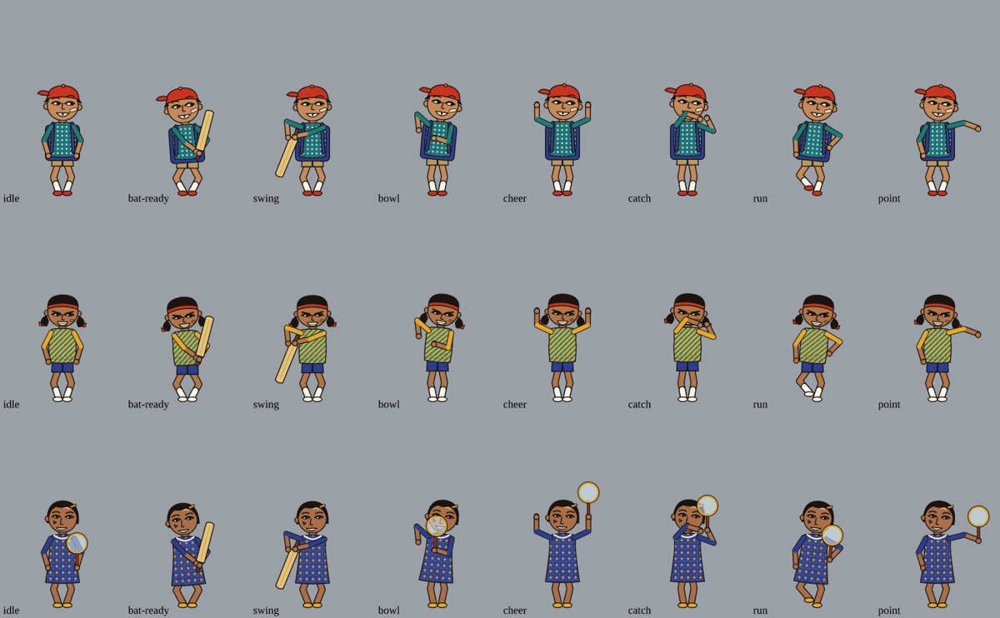
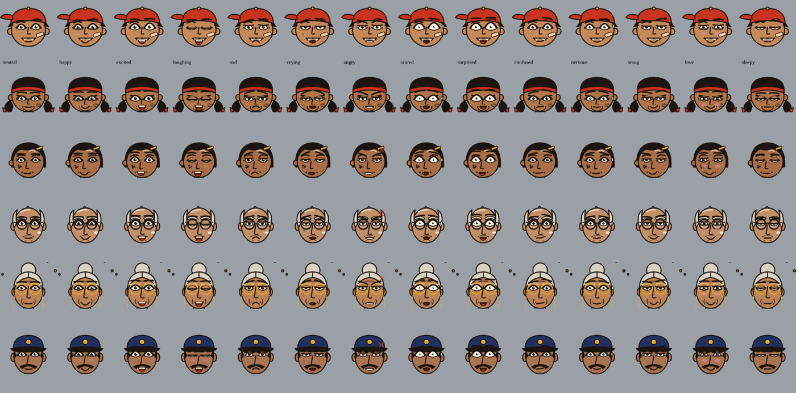
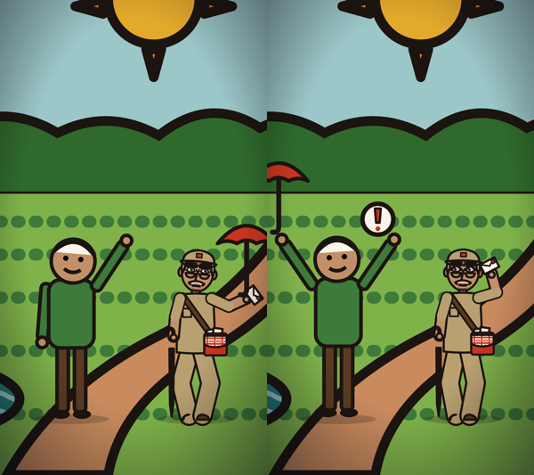

# Rangput Animation Maker

**An offline cartoon maker for Windows.** Write your story in a spreadsheet, add voice recordings (optional), double-click, and get a finished vertical video (1080×1920, YouTube Shorts / Reels / TikTok size) in the hand-drawn **Rongpat** style, inspired by Bengali folk art (Kalighat pat, Gond, Madhubani and modern Bengali illustration).

No internet, no AI service, no accounts, no subscriptions. It runs on a normal Windows laptop, with no graphics card needed.



---

## Contents

1. [What it can do](#what-it-can-do)
2. [Download and install (Windows)](#download-and-install-windows)
3. [Make your first video in 5 minutes](#make-your-first-video-in-5-minutes)
4. [The scene sheet, column by column](#the-scene-sheet-column-by-column)
5. [Characters, places and objects](#characters-places-and-objects)
6. [Moves, actions and expressions](#moves-actions-and-expressions)
7. [Adding your own characters, objects and places](#adding-your-own-characters-objects-and-places)
8. [Updating the character bible](#updating-the-character-bible)
9. [Fixing problems](#fixing-problems)
10. [How it works (for developers)](#how-it-works-for-developers)
11. [Licences and credits](#licences-and-credits)

---

## What it can do

| | |
|---|---|
| **40 ready-made characters** | Kids, families, teachers, a doctor, police, street sellers, animals and folklore spirits, all full body. |
| **36 places** | Homes, kitchen, school (gate, classroom, lab, corridor, playground), police station, hospital, market, rooftop, river, village, haunted banyan grove and more. |
| **Moving arms and legs** | All 30 human characters are rigged: they walk, run, bowl, swing a bat, catch, cheer, clap, wave, point, shrug, think, facepalm, cover their face and more. |
| **Automatic expressions** | 19 expressions (happy, angry, scared, crying, smug …) chosen automatically from what a character says and does. Eyes look at whoever is speaking. |
| **Lip-sync** | Mouths move with your voice recordings. Characters blink and breathe on their own. |
| **Objects** | Ball, bat and stumps built in; any picture you add can be held, thrown, dropped, spun or swung. |
| **Camera** | Wide, medium, close-up, push-in, pull-out, pans, follow, follow-the-ball, camera shake. |
| **Sound** | 6 music moods made from Bengali folk instruments (dotara, tabla, bansuri, bells) that automatically get quieter under voices, plus 23 sound effects. You can add your own sounds. |
| **Subtitles** | English and Bangla, burned into the video. |
| **Your own art** | Add your own characters, objects and places. They rig themselves automatically. |



---

## Download and install (Windows)

1. Go to the **[Releases](../../releases)** page of this repository.
2. Download **`Rangput-Animation-Maker-Windows.zip`** (about 120 MB). It contains everything, including Python and the video tools.
3. Right-click the zip → **Extract All…** → choose a simple folder such as `C:\RangputAnimationMaker` or `D:\Softwares` → **Extract**.
4. Open the extracted **`RongpatStudio`** folder. You'll see:

```
RongpatStudio/
├── 1 - New Project.bat
├── 2 - Preview Video (fast).bat
├── 3 - Make Final Video.bat
├── 4 - Check One Shot (picture).bat
├── 5 - Update Library.bat
├── Rongpat Studio Guide.html        ← full illustrated guide, open it in your browser
├── Characters - names to type.png
├── Places - names to type.png
├── engine/      the program and the character bible
├── library/     your own characters, objects, places
├── projects/    your stories (one folder each)
└── python/      built-in Python + video tools (don't change)
```

The first time you double-click a `.bat` file, Windows may say **"Windows protected your PC"**. Click **More info → Run anyway**. This happens because the files are new and unsigned, not because they're unsafe.

**Requirements:** Windows 10 or 11, 64-bit, about 1 GB free space. More CPU cores make faster videos.

> The repository itself contains the program, the bible and the guide, but not the 330 MB built-in Python folder (it's too big for a Git repository). For a ready-to-run copy, always use the **Releases** download.

---

## Make your first video in 5 minutes

1. **Try the demo.** Double-click **`2 - Preview Video (fast)`**, type the number of **Demo - The Last Ball**, then press Enter twice. A short cricket video is made and opens by itself.
2. **Start your own story.** Double-click **`1 - New Project`** and type a name. A folder opens containing `scenes.xlsx` and empty `voice`, `images` and `sounds` folders.
3. **Record your lines (optional).** Save each line as its own file (wav, mp3 or m4a) in the `voice` folder, e.g. `01_mitul.wav`. Without voices, the subtitles still tell the story.
4. **Write the scene sheet.** Open `scenes.xlsx`. Write **one row per shot**: where it happens, who is in it, what they do, who speaks, the subtitle, music. The row under the headings explains every column, and dropdowns help you pick places and moods. **Save and close Excel.**
5. **Preview.** Double-click **`2 - Preview Video (fast)`** for a quick low-resolution check. To re-check only part of it, type shot numbers such as `4` or `3-6` when it asks.
6. **Check one shot instantly.** **`4 - Check One Shot (picture)`** draws one picture of one shot in seconds.
7. **Make the final video.** **`3 - Make Final Video`** makes the full HD MP4, saved in your project's `output` folder.

**Speed:** a 60-second preview takes about 1–5 minutes; the final video about 5–15 minutes, depending on your CPU.

---

## The scene sheet, column by column

Each row is one shot. Empty cells are fine: most columns fall back to something sensible or to the shot before.

| Column | What to write | Example |
|---|---|---|
| **Shot** | Just a number for you. | `3` |
| **Place** | A place name (see the Places list), `title` for a title card, or a picture file from your project's `images` folder. | `school-playground` |
| **View** | Which part of the place to show: `left`, `center`, `right`, or 0–100. | `center` |
| **Time** | `day`, `evening` or `night` (tints the whole scene). | `night` |
| **Camera** | `auto`, `wide`, `medium`, `close`, `push-in`, `pull-out`, `pan-left`, `pan-right`, `follow`, `ball`. Add `shake` for a shaky camera. | `close shake` |
| **Focus** | Who the camera looks at (default: the speaker). | `pupu` |
| **Cast** | Who and what is in the shot and where, separated by commas. Positions: `far-left`, `left`, `center`, `right`, `far-right` or a number −100…100. Extra words: `back`, `front`, `flip`, `hidden`. Empty = same cast as before. | `mitul left, pupu center, stumps 22 back` |
| **Actions** | `who: action`, separated by `;`. Several actions for one character with `,`. Time them with `@seconds`. | `mitul: bowl @1.2; pupu: swing @1.7` |
| **Speaker** | Whose mouth moves. Two speakers: `tutul; mitul`. | `mitul` |
| **Voice** | The file in the `voice` folder. Two clips: `a.wav; b.wav @2.5`. | `02_mitul.wav` |
| **Subtitle** | The caption (English or Bangla). Use `\|` to split it into two captions shown one after another; start with `^` to show it at the bottom. For a title card, this is the title. | `Why? \| Because…` |
| **Emote** | A symbol over a head: `!` `?` `heart` `zzz` `sweat` `anger` `idea` `music` `sparkle` `shock`. | `pupu: ! @1` |
| **SFX** | Built-in sound effects or your own files from `sounds`, with times. | `whoosh @0.5, pop @1.9` |
| **Music** | `calm`, `spooky`, `comic`, `tense`, `sweet`, `happy`, `none`. Empty = keep the previous mood. | `tense` |
| **Duration** | Seconds. Empty = automatic (fits the voice). | `3` |
| **Transition** | `cut`, or `fade` (a quick dip to black into this shot). | `fade` |
| **Notes** | Anything for yourself. Ignored. | |
| **Expression** | Optional. Faces change automatically; set one here to choose it yourself. | `pupu: angry @1.2` |

**A tiny example:**

| Place | Time | Camera | Cast | Actions | Speaker | Voice | Subtitle |
|---|---|---|---|---|---|---|---|
| title | evening | | | | | | শেষ বল \| The Last Ball |
| school-playground | evening | wide | mitul left, pupu center, stumps 22 back | pupu: bat-ready; mitul: hold-ball, bowl @1.2; ball: in-hand mitul, bowl mitul pupu @1.55 | mitul | 02_mitul.wav | Get in line! |
| | | close shake | | pupu: swing @1.7; ball: hit-up @1.9 | pupu | 10_pupu.wav | FULL POWER! |

Every `scenes.xlsx` also has reference tabs: **Characters**, **Places**, **Actions** (moves, objects, expressions, cameras) and **Sounds**.

---

## Characters, places and objects



**Fully animated puppets:** `mishti` (ginger cat: sits, runs, leaps, meows, hisses), `mechho` (fish-loving ghost: floats, screams, cries, glows, holds a fish or sweet), `tutul` (little kid: talks, smiles, offers a sweet).

**Rigged humans (moving arms and legs):** tuli, ronju, dida, pupu, moyna, ghontu, bhombol, kalo-megh, shubho, rini, baba, ma, mitul, babai, jhumpa, tutul-card, anko-sir, mitali, ghonta-da, robin, montu, kashem, bablu, pintu, dr-ruksana, shefali, gopal, haridas, shiyal, jol-konya.

**Animals and spirits (simpler rig: head nods and talks, body breathes):** mishti-card, bagha, gyani, chhotu, rupoli, dhol, kumir, petni, bot-dadu.

**Objects:** `ball`, `bat`, `stumps`, plus anything you add to `library\props`.



---

## Moves, actions and expressions



**Moving around (everyone):** `enter-left`, `enter-right`, `exit-left`, `exit-right`, `walk-to <pos>`, `run-to <pos>`, `jump` (`x2`, `x3`), `hop`, `shake`, `scared`, `happy`, `dance`, `spin`, `fall`, `sleep`, `float`, `glow`, `appear`, `vanish`, `turn`, `grow`, `shrink`.

**Body moves (rigged characters):** `bat-ready`, `swing`, `bowl`, `throw`, `catch`, `hold-ball`, `keeper`, `cheer`, `clap`, `wave`, `arm-dance`, `point`, `point-left`, `shrug`, `think`, `facepalm`, `hands-on-hips`, `cover-face`, `six`, `out`, `eat`, `magnify`, `carry-bat`, `relax`.

**Puppet-only:** `sit`, `leap`, `hiss` (Mishti); `offer` (Tutul); `hold-fish`, `hold-sweet`, `cry` (Mechho).

**Object actions:** `in-hand <who> [left|right]`, `bowl <from> <to>`, `throw <from> <to>`, `hit-up`, `hit-left`, `hit-right`, `fly-in <who>`, `drop`, `spin`, `bounce`, `swing`, `appear`, `vanish`.

**Expressions** (automatic, or set in the Expression column): neutral, happy, excited, laughing, sad, crying, angry, scared, surprised, shocked, confused, thinking, nervous, embarrassed, smug, sleepy, disgusted, love, stern.

How the automatic choice works:
- **What they say:** a line ending in "!" (and how loud it is), "?", or "…".
- **What they do:** cheering means excited, covering the face means scared, a facepalm means embarrassed, hands on hips means stern.
- **Emotes:** "!" means surprised, "anger" means angry, "sweat" means nervous.
- **Listening:** listeners react to strong lines, and eyes follow the speaker.



---

## Adding your own characters, objects and places

Put files in the **`library`** folder, then double-click **`5 - Update Library`**. The file name is the name you type in the sheet. Anything with the same name as a built-in one replaces it, and deleting the file brings the original back.

| What you add | Where | What happens automatically |
|---|---|---|
| A character drawn **in parts** (SVG with groups named `head`, `body`, `arm-left`, `arm-right`, `leg-left`, `leg-right`) | `library\characters` | **Full rig:** shoulders, hips and neck are found automatically. Arms do every move, legs walk, the head nods and talks, hands hold objects. |
| A single flat picture (PNG with transparent background, or SVG) | `library\characters` | **Simple rig:** head nods, tilts and talks; body breathes, leans and bounces. |
| An object (PNG or SVG) | `library\props` | Can be held, thrown, dropped, spun, swung, bounced or placed. |
| A place (PNG, JPG or SVG, landscape works best) | `library\places` | Used as a background with camera moves. |

**Optional settings file:** put a `.json` file with the same name next to the picture.

```json
{ "name": "Dadu", "bn": "দাদু", "size": "adult", "description": "Grandfather with a cane" }
```
Sizes for characters: `adult`, `tall`, `kid`, `small-kid`, `big-animal`, `animal`, `small-animal`, or a number (adult = 475).

```json
{ "name": "Umbrella", "size": "large", "grip": "bottom" }
```
Objects: size `tiny`, `small`, `medium`, `large`, `huge` or a number; grip (where a hand holds it) `top`, `center`, `bottom`.

```json
{ "name": "Dadu's shop", "floor": 0.88 }
```
Places: `floor` is where feet stand, from 0 (top) to 1 (bottom).

**Drawing a character in parts with Inkscape (free):**
1. Draw the character standing and facing you, with the arms hanging straight down.
2. Select all the shapes of the left arm, then **Object → Group** (Ctrl+G).
3. Open **Object → Object Properties**, set **ID** to `arm-left`, and click **Set**.
4. Repeat for `arm-right`, `leg-left`, `leg-right`, `head` and `body`.
5. **Save As → Plain SVG** into `library\characters`.



---

## Updating the character bible

The cast and places live in folders, not inside the code, so the bible can grow or change at any time:

- **New or changed bible boards:** put the board files (`.dc.html` / `.html`) and any `*.rig.json` files in `library\bible-import`, then run **`5 - Update Library`**. Characters and places with the same names are replaced, new ones are added, and blinking, lip-sync and rigs are set up automatically.
- **Update packs:** unzip them into the `library` folder and run **`5 - Update Library`**.
- **Program updates:** unzip on top of the `RongpatStudio` folder and choose **Replace**. Your projects and library are never touched.

`5 - Update Library` also refreshes the Characters and Places lists inside all your projects' `scenes.xlsx` files (close Excel first).

---

## Fixing problems

| Message or problem | What to do |
|---|---|
| **"PROBLEM IN THE SCENE SHEET: …"** | It names the row and what's wrong (often an unknown name, with suggestions). Fix that cell and run again. |
| **"No scene sheet (scenes.xlsx) found"** | `scenes.xlsx` must sit directly inside the project folder, next to `voice`. Unzipping sometimes makes an extra inner folder. |
| **"voice file … is not in the voice folder"** | The file name must match exactly (e.g. `02_mitul.wav`, not `02_Mitul.mp3`). |
| **"Permission denied" on scenes.xlsx** | Close it in Excel first. |
| **"Windows protected your PC"** | **More info → Run anyway.** |
| **Antivirus blocks it** | Allow the RongpatStudio folder. It contains Python, ffmpeg and resvg, all open-source. |
| **Window looks stuck on "Making the sound"** | That step can take 1–3 minutes. Wait. |
| **A character is in the wrong spot or timing is off** | Change the position (`left` → `-60`), the View or the Camera; add `@seconds` to actions, emotes and sounds. Use **4 - Check One Shot** to check quickly. |
| **Something else crashed** | Open an [Issue](../../issues) and paste the text from the black window. |

---

## How it works (for developers)

Pure Python, fully offline:

```
app/RongpatStudio/engine/
├── rongpat/
│   ├── studio.py       command line (new / make / still / update-library), parallel rendering, ffmpeg encoding
│   ├── engine.py       scene-sheet parser, shot planner, camera, characters, objects, captions
│   ├── rig.py          two-bone IK rigs, pose library, auto-rig loader and drawing
│   ├── expressions.py  expression parameters, automatic expression choice, gaze, face overlay drawing
│   ├── library.py      bible import, user characters/objects/places, layered-part detection
│   ├── audio.py        music moods (Karplus-Strong dotara, tabla, bansuri, bells), SFX, voice ducking, mixing
│   ├── template.py     scenes.xlsx generator with dropdowns and reference tabs
│   ├── puppets.py      hand-animated Mishti, Mechho, Tutul
│   └── sets.py         kitchen and stairwell sets
└── assets/             characters/*.svg, places/*.svg, rigs/*.json, fonts
```

- **Rendering:** each frame is an SVG (540×960 units), rasterised by [resvg](https://github.com/linebender/resvg) via `resvg_py` on all CPU cores, piped into ffmpeg (H.264, 30 fps, AAC, loudness-normalised to about −13 LUFS).
- **Rigs:** characters are rebuilt from their bible body parts. Arms and legs are two-bone IK chains driven by hand and foot targets from the pose library. Hand props follow the hand.
- **Auto-rig:** `tools/autorig_bible.py` re-runs the bible's body code with the limb drawing functions captured, separating arms, legs and hand props into `assets/rigs/*.json`. User art with named parts is rigged at load time (`library.find_parts`).
- **Run from source** (any OS with Python 3.11+):
  ```bash
  pip install numpy scipy pillow openpyxl resvg_py imageio-ffmpeg
  cd app/RongpatStudio/engine
  python -m rongpat make "../projects/Demo - The Last Ball" --preview
  ```
- **Windows package:** see [`tools/BUILD_WINDOWS.md`](tools/BUILD_WINDOWS.md).

---

## Licences and credits

**Free to use, not to sell.** You can download, use, change and share Rangput Animation Maker for free for any non-commercial purpose. Selling it, selling the artwork, or making money with it or its videos needs written permission from the author. Please credit "Rangput Animation Maker / Rongpat by arestadul-max" when you share.

- Program code: [PolyForm Noncommercial 1.0.0](https://polyformproject.org/licenses/noncommercial/1.0.0/) (see [`LICENSE`](LICENSE)).
- Rongpat character bible, places, artwork, music and demos: [CC BY-NC 4.0](https://creativecommons.org/licenses/by-nc/4.0/) (see [`LICENSE`](LICENSE)).
- Third-party software and fonts bundled in the Windows release: see [`THIRD_PARTY_NOTICES.md`](THIRD_PARTY_NOTICES.md). This includes ffmpeg (GPL), resvg (MPL-2.0/Apache-2.0), Python (PSF), NumPy/SciPy/Pillow/openpyxl (BSD/MIT-style), and the Hind Siliguri, Rozha One and Inter fonts (SIL Open Font License).
